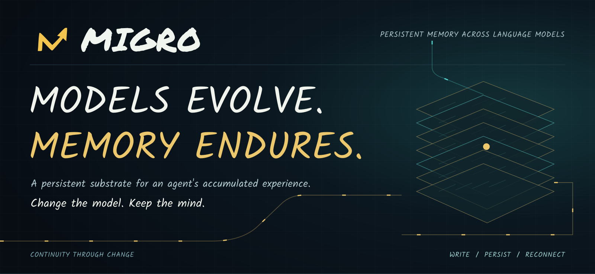
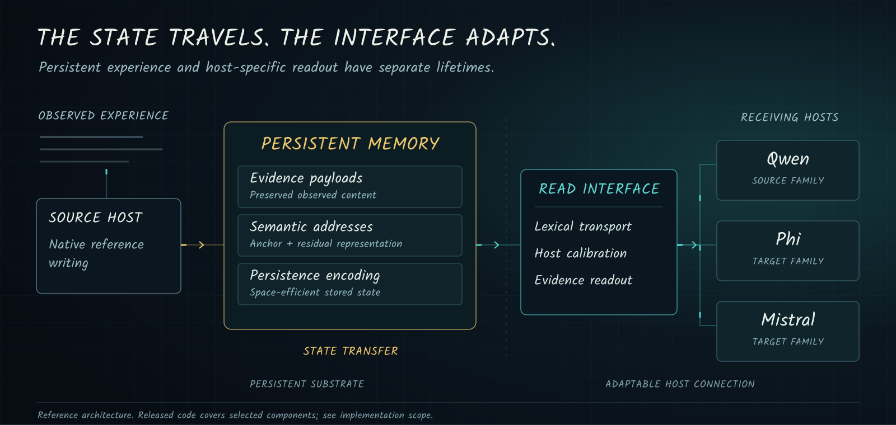
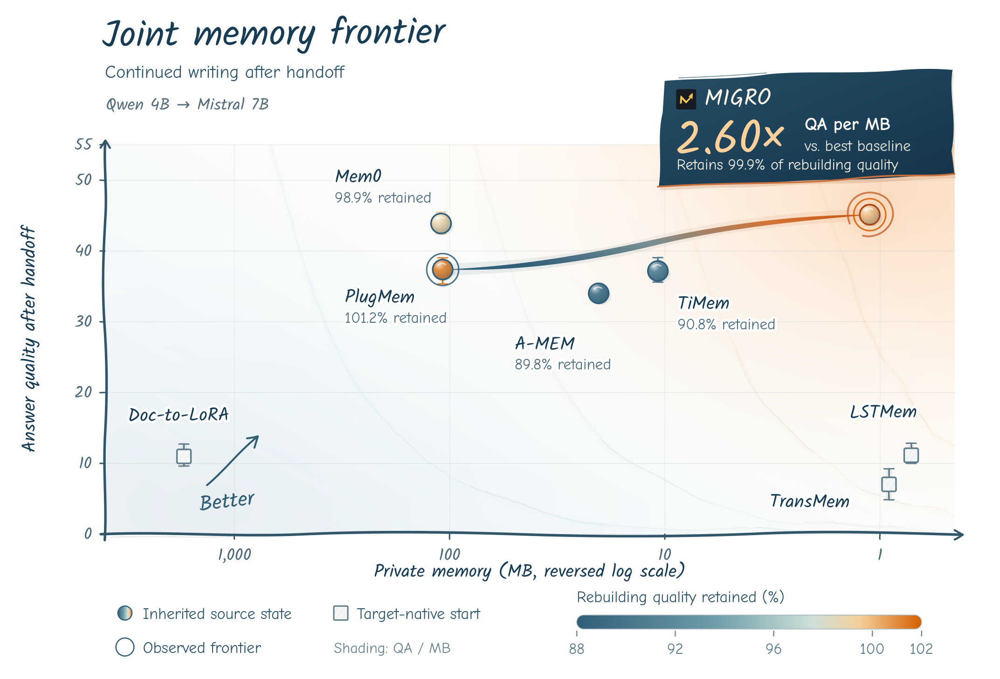

<p align="center">
  <a href="README.md">English</a> &nbsp; · &nbsp; <a href="README.zh-CN.md">简体中文</a> &nbsp; · &nbsp; <strong>Español</strong>
</p>

<p align="center">
  
</p>

<p align="center">
  <a href="https://arxiv.org/abs/2611.15315"></a>
  <a href="https://zoumingxi.github.io/MIGRO/"></a>
  
  <a href="LICENSE"></a>
</p>

<p align="center">
  <strong>Memoria persistente entre modelos de lenguaje</strong><br>
  Una base compartida para la experiencia acumulada. Interfaces adaptables para los modelos que la utilizan.
</p>

<p align="center">
  <a href="#inicio-rápido">Inicio rápido</a> &nbsp; · &nbsp;
  <a href="https://arxiv.org/abs/2611.15315"><strong>Artículo ↗</strong></a> &nbsp; · &nbsp;
  <a href="https://zoumingxi.github.io/MIGRO/"><strong>Prueba la demo ↗</strong></a> &nbsp; · &nbsp;
  <a href="#por-qué-migro">Visión general</a> &nbsp; · &nbsp;
  <a href="#diseño-del-sistema">Arquitectura</a> &nbsp; · &nbsp;
  <a href="#evidencia-experimental">Resultados</a> &nbsp; · &nbsp;
  <a href="docs/README.md">Documentación</a> &nbsp; · &nbsp;
  <a href="#cita">Cita</a>
</p>

---

## Por qué MIGRO

**MIGRO conserva la experiencia a largo plazo cuando cambia el modelo de lenguaje.** Las observaciones, las relaciones históricas y las direcciones de recuperación se guardan en un estado persistente que los modelos sucesivos pueden leer y ampliar.

- **Memoria útil.** La evidencia exacta y la selección según la consulta ayudan a responder sobre eventos, revisiones y contexto.
- **Experiencia portable.** Las interfaces permiten acceder al estado heredado y seguir incorporando observaciones.
- **Crecimiento económico.** Las direcciones compactas y los archivos reversibles reducen el almacenamiento y conservan la evidencia guardada.

## Novedades

- **2026-11-12** — [Recursos compartidos publicados](https://github.com/zOUMINGXI/MIGRO/releases/tag/runtime-assets-20261112), con pesos del núcleo y de las interfaces, configuración y verificación.
- **2026-11-11** — [Informe técnico publicado en arXiv](https://arxiv.org/abs/2611.15315).

## Inicio rápido

**Pruébalo en el navegador.** [Abre la demo interactiva](https://zoumingxi.github.io/MIGRO/) para comparar respuestas registradas e inspeccionar la evidencia. También puedes [descargar la demo sin conexión](https://github.com/zOUMINGXI/MIGRO/raw/refs/heads/main/demo/MIGRO-Handoff.zip).

**Instala desde el código fuente.** La instalación básica ofrece herramientas de presentación de resultados y controles de memoria textual.

~~~bash
git clone https://github.com/zOUMINGXI/MIGRO.git
cd MIGRO
python3 -m venv .venv
source .venv/bin/activate
python -m pip install -e .
python scripts/render_results.py --help
~~~

**Ejecuta el sistema de memoria.** Sigue la [configuración del entorno](docs/runtime.es.md) para instalar dependencias, descargar recursos, compilar los núcleos y ejecutar la verificación. La [guía local](demo/README.md#run-your-own-session) explica cómo generar respuestas nuevas con los modelos base y de reranking necesarios.

[Índice de documentación](docs/README.md) · [Comandos de experimentos](docs/experiments.md) · [Alcance de la publicación](docs/release_scope.md)

## Diseño del sistema

<p align="center">
  
</p>

### The Handoff · demo interactiva

Un proveedor de cocinas pide la aprobación justo cuando Leah cambia de asistente. Los últimos correos incluyen el nuevo presupuesto, los planos y las opciones de entrega; su límite de gasto, las medidas del lugar y las restricciones del edificio están en la correspondencia de abril. Ponte al frente de la decisión: elige qué hacer, recupera el contexto anterior y reconsidera. Después, compara las respuestas reales de cinco condiciones de memoria. Un segundo caso reconstruye nuestro propio problema de soporte para descargar la demo a partir de los commits de publicación.

[](https://zoumingxi.github.io/MIGRO/)

[**Abrir la demo interactiva ↗**](https://zoumingxi.github.io/MIGRO/) · [Descargar la demo sin conexión (.zip)](https://github.com/zOUMINGXI/MIGRO/raw/refs/heads/main/demo/MIGRO-Handoff.zip) · [Ejecutar tu propia sesión](demo/README.md#run-your-own-session)

Abre la demo en cualquier navegador, sin descargar ni instalar nada. Explora las ejecuciones registradas, cambia de condición de memoria e inspecciona la evidencia recuperada. Para generar respuestas nuevas a partir de tus propias entradas, utiliza el entorno local enlazado arriba.

### Una base persistente con conexiones adaptables

MIGRO separa la experiencia almacenada de los mecanismos que la ponen a disposición de un modelo anfitrión concreto.

**La escritura mantiene el vínculo con el historial observado.** La escritura nativa de referencia utiliza el modelo de origen para construir memoria a partir de observaciones. El contenido persistente y los metadatos mantienen la relación entre lo almacenado y la experiencia de la que procede.

**Las direcciones y la codificación cumplen funciones distintas.** Las direcciones semánticas permiten seleccionar evidencia. La representación Anchor + Residual se evalúa frente a controles que usan solo Anchor o direcciones completas. La codificación persistente se evalúa por separado, incluida la restauración exacta de los identificadores de origen, la geometría de las direcciones y los metadatos.

**La interfaz de lectura se adapta al modelo receptor.** El transporte léxico conecta las representaciones de origen con el vocabulario y la interfaz de embeddings del destino. La calibración adapta esa conexión cuando el protocolo lo permite. Esta separación hace explícita la adaptación específica de cada modelo.

El diagrama describe la arquitectura de investigación. El código publicado incluye el estado persistente, los núcleos de codificación exacta y los puntos de entrada de evaluación. Los checkpoints compartidos y los conjuntos de datos se suministran por separado; consulta la [configuración del entorno](docs/runtime.es.md).

[Arquitectura y contratos de componentes](docs/system_overview.md) · [Detalles de implementación](docs/implementation.md) · [Configuraciones de ablación](configs/ablations)

### Transferir el estado o reconstruir el historial

El protocolo de migración distingue dos operaciones concretas:

|Operación|Estado persistente|Trabajo en el destino|
|---|---|---|
|**State Transfer**|Reutilizar el estado de memoria existente.|Conectarlo con el modelo receptor; se permite una calibración limitada de la interfaz de lectura, que se informa por separado.|
|**Full-History Rebuilding**|Volver a construir la memoria a partir del historial original completo.|Ejecutar el proceso de construcción en el destino, incluido el entrenamiento de memoria específico del modelo cuando sea necesario.|

**State Transfer** significa transferencia de estado; **Full-History Rebuilding**, reconstrucción del historial completo. La etiqueta corresponde a la ejecución. Un método puede tener resultados de transferencia y controles reconstruidos de forma independiente en el destino. Reconstruir la memoria no implica, por sí solo, ajustar el modelo base.

[Operaciones de migración y presupuestos de calibración](docs/migration_protocol.md)

## Evidencia experimental

El informe evalúa la calidad de respuesta, la continuidad entre modelos y el almacenamiento. Cada medición corresponde a su propia cohorte y alcance de contabilización.

| Estudio | Resultado representativo |
|---|---|
| Preguntas a largo plazo · LongMemEval-S | **68.40** con Qwen 4B |
| Escritura continuada · Qwen 4B → Mistral 7B | **45.13**, frente a **45.19** al reconstruir todo el historial |
| Historiales BEAM de un millón de tokens | **1.857 MB** de estado privado por historial, media de cinco historiales |
| Despliegue compartido · 1,000 memorias independientes | **2.154 MB por memoria**, incluidos los recursos compartidos necesarios |

[Tablas completas y métodos de referencia](docs/evaluation.es.md) · [Métricas](docs/performance_protocol.md) · [Migración](docs/migration_protocol.md)

<p align="center">
  <a href="assets/joint_frontier.png"></a>
</p>

<p align="center">
  <strong>Conserva la experiencia. Sigue escribiendo.</strong><br>
  Escritura continuada tras el traspaso Qwen 4B → Mistral 7B: calidad de respuesta, espacio de memoria privada y calidad conservada respecto a la reconstrucción en el destino.
</p>

## Componentes publicados

El repositorio ofrece puntos de entrada a la implementación y al flujo de evaluación.

|Componente|Función|Código|
|---|---|---|
|**Estado persistente**|Anclas y residuos compartidos, vínculos exactos de contenido, guardado/restauración y escritura continuada.|[`migro.memory`](src/migro/memory.py)|
|**Codificación exacta**|Candidatos de contenido literal y causal, codificación de direcciones/archivos y núcleos nativos.|[`migro.backend`](src/migro/backend)|
|**Ejecuciones de benchmarks**|MAB incremental, presupuestos de lectura emparejados, puntuación según formato y continuación tras la transferencia.|[Ejecutar experimentos](docs/experiments.md)|
|**Transporte**|Transporte por partes adaptado al vocabulario, composición de fronteras y correspondencia léxica.|[`migro.transport`](src/migro/transport.py)|
|**Calibración**|Interfaces residuales y condicionadas por evidencia.|[`migro.calibration`](src/migro/calibration.py)|
|**Escritura de referencia**|Escritura causal a partir del historial observado con el modelo anfitrión congelado.|[`migro.native_writer`](src/migro/native_writer.py)|
|**Tratamiento de observaciones**|Formato determinista y anotaciones temporales.|[`migro.observations`](src/migro/observations.py)|
|**Controles de memoria**|Referencias portátiles de BM25 y ventanas recientes.|[`migro.controls`](src/migro/controls.py)|
|**Análisis emparejado**|Comparación de grupos emparejados e intervalos bootstrap a nivel de conversación.|[`migro_eval.ablations`](src/migro_eval/ablations.py)|

### Instalación

Utiliza Python 3.10 o posterior. Las herramientas de resultados y los controles de texto portátiles usan la biblioteca estándar. Los extras opcionales transport y analysis instalan las dependencias de esos módulos.

```bash
python -m pip install -e .
python -m pip install -e '.[transport,analysis]'
```

Para el sistema de memoria y los puntos de entrada de evaluación, instala `.[runtime,benchmarks]`, compila los núcleos incluidos y proporciona los recursos compartidos del modelo. [Configuración del entorno](docs/runtime.es.md) · [Ejecutar experimentos](docs/experiments.md) · [Contratos de componentes](docs/implementation.md)

### Informes y análisis emparejado

```bash
# Mostrar los resultados agregados incluidos en el repositorio.
python scripts/render_results.py

# Agregar un grupo LoCoMo ya puntuado.
python scripts/summarize_locomo.py /path/to/scored_records.json --output summary.json

# Consultar la interfaz de análisis de ablaciones emparejadas.
python scripts/summarize_ablations.py --help

# Ejecutar las comprobaciones de componentes e informes.
python -m unittest discover -s tests -v
```

Las herramientas de informes consumen registros ya puntuados y, por defecto, requieren grupos completos. La puntuación de cada pregunta sigue correspondiendo al proceso previo. Las pruebas de dependencias opcionales se omiten si estas no están disponibles.

[Formato de entrada de los informes](docs/reporting_tools.md) · [Uso del análisis emparejado](docs/implementation.md#paired-analysis)

### Estructura del repositorio

```text
assets/                 Identidad visual y figuras del sistema
src/migro/              Transporte, calibración, escritura y controles
src/migro_eval/         Agregación de registros puntuados y análisis emparejado
configs/ablations/      Contratos experimentales de cada componente
docs/                   Arquitectura, protocolos y notas de implementación
results/                Tablas seleccionadas del manuscrito (CSV / JSON)
scripts/                Puntos de entrada de informes y análisis
tests/                  Comprobaciones de componentes e informes
```

## Estado de la publicación

Los [recursos compartidos del entorno](https://github.com/zOUMINGXI/MIGRO/releases/tag/runtime-assets-20261112) y la implementación están disponibles. Incluyen la memoria persistente, los núcleos, las interfaces, configuración y verificación, la demo y los comandos documentados. Los modelos base, el reranker y los conjuntos de datos se obtienen de sus autores. El [alcance de la publicación](docs/release_scope.md) detalla los componentes y el trabajo de reproducción pendiente.

El código y los recursos propios de MIGRO usan [Apache-2.0](LICENSE). Los componentes de terceros conservan las licencias de los [avisos correspondientes](THIRD_PARTY_NOTICES.md).

## Contribuir

Las mejoras de documentación, integraciones, interfaces y evaluación son bienvenidas. Consulta la [guía de contribución](CONTRIBUTING.md), [informa de un problema](https://github.com/zOUMINGXI/MIGRO/issues/new?template=bug_report.md) o [propón una mejora](https://github.com/zOUMINGXI/MIGRO/issues/new?template=feature_request.md).

## Cita

Si MIGRO resulta útil para tu investigación, cita el [informe técnico](https://arxiv.org/abs/2611.15315). Los metadatos están disponibles en [CITATION.cff](CITATION.cff).

~~~bibtex
@article{zou2026migro,
  title = {{MIGRO}: A Decoupled and Portable Long-Term Memory System for Language Models},
  author = {Zou, Mingxi and
            Xu, Yinghui and
            Chen, Jiaxiang and
            Liang, Langzhang and
            Zhu, Wei and
            Ye, Peng and
            Zhao, Runkai and
            Jiang, Ruoxi and
            Chen, Sijin and
            Wang, Song and
            Wang, Zhuo and
            Qu, Lizhen and
            Xu, Zenglin},
  year = {2026},
  eprint = {2611.15315},
  archivePrefix = {arXiv},
  primaryClass = {cs.AI},
  url = {https://arxiv.org/abs/2611.15315}
}
~~~
