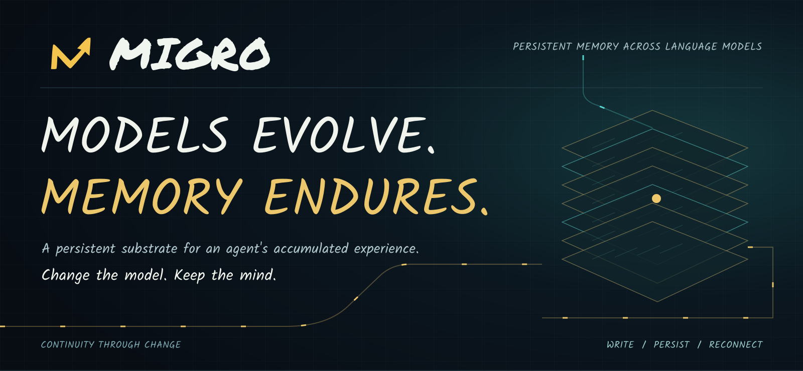
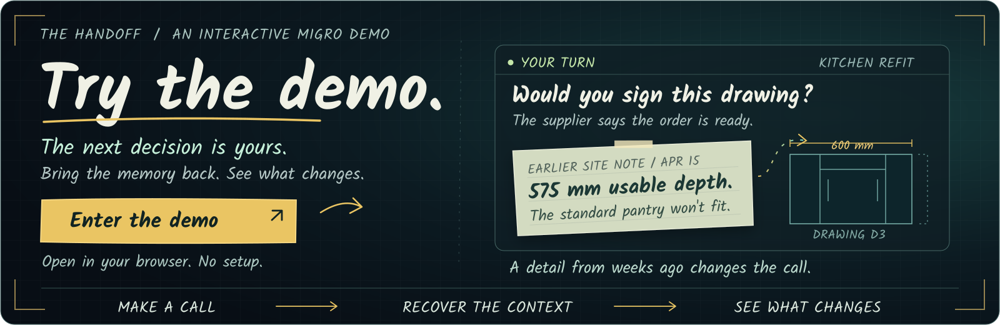
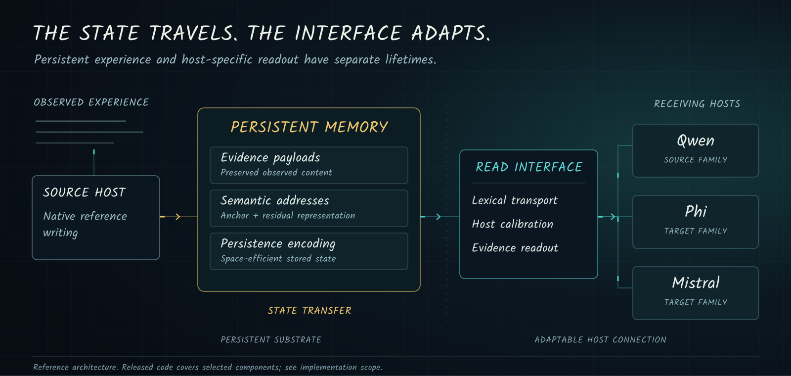
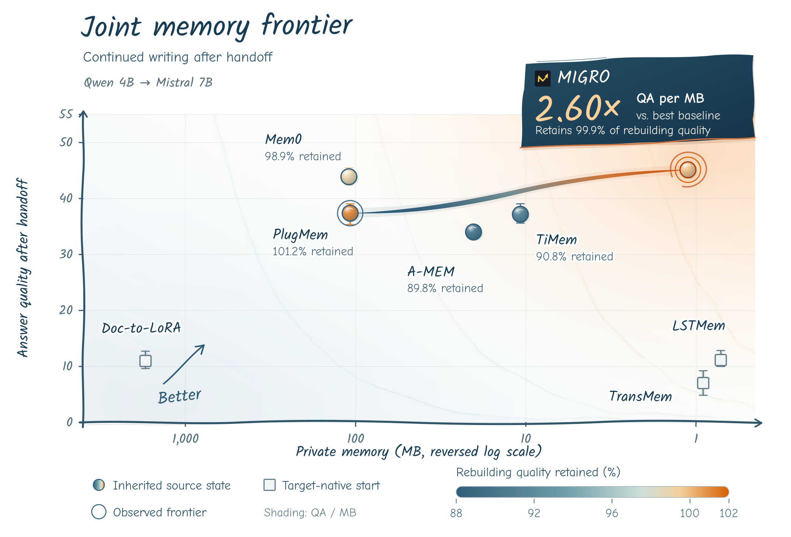
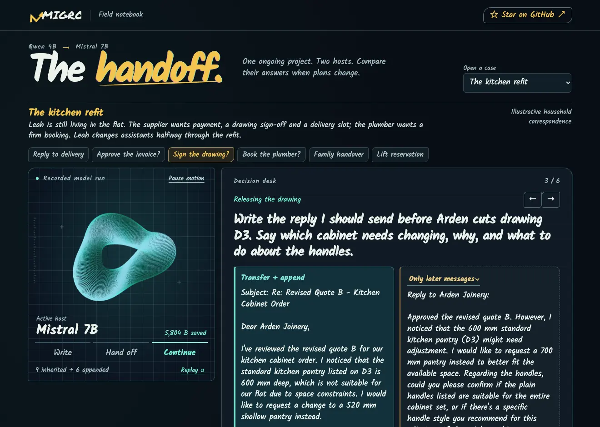

<p align="center">
  
</p>

<p align="center">
  <a href="https://migro-handoff.lucentsole3.chatgpt.site">
    
  </a>
</p>

<p align="center">
  <strong>Persistent memory across language models</strong><br>
  A shared substrate for accumulated experience. Adaptable interfaces for the models that use it.
</p>

<p align="center">
  <a href="https://migro-handoff.lucentsole3.chatgpt.site"><strong>Try the demo ↗</strong></a> &nbsp; · &nbsp;
  <a href="#the-continuity-problem">Overview</a> &nbsp; · &nbsp;
  <a href="#system-design">Architecture</a> &nbsp; · &nbsp;
  <a href="#experimental-evidence">Evidence</a> &nbsp; · &nbsp;
  <a href="#released-components">Code</a> &nbsp; · &nbsp;
  <a href="docs/system_overview.md">System notes</a> &nbsp; · &nbsp;
  <a href="docs/performance_protocol.md">Evaluation protocol</a>
</p>

---

An agent's model can change in an afternoon. Its useful history may take months to accumulate.

That history carries the context behind decisions: what a user values, which constraints still apply, how a plan changed, and what happened before the current conversation. As models evolve, preserving access to that experience becomes a systems problem.

**MIGRO is a memory architecture for carrying accumulated experience across language-model hosts.** Its central design separates a persistent memory substrate from the interfaces through which individual backbones read it. Writing, storage and cross-model access are treated as parts of the same continuity problem.

> **The ambition: let improvements in the model build on the experience already accumulated by the agent.**

## The continuity problem

Long-lived agents operate on a different timescale from the models that power them. A deployment may change backbone, tokenizer or model family while its history continues to grow. Each change raises a practical question: **what must be carried forward, and what must be rebuilt?**

MIGRO approaches that question at three levels:

|System concern|Design objective|
|---|---|
|**Memory utility**|Recover evidence from accumulated history and use it to answer questions.|
|**Persistent footprint**|Represent content and retrieval addresses compactly, with explicit accounting for stored state and shared deployment assets.|
|**Host continuity**|Reconnect existing state to a receiving backbone through a host-specific read interface.|

These objectives shape both the architecture and the evaluation. A smaller archive must still restore the intended state. A successful host connection must still provide useful evidence. A migration comparison must identify the operation actually performed.

## System design

<p align="center">
  
</p>

<p align="center">
  <a href="assets/joint_frontier.png"></a>
</p>

<p align="center">
  <strong>Carry the experience. Keep writing.</strong><br>
  Continued writing after a Qwen 4B → Mistral 7B handoff: answer quality, private memory footprint and quality retained relative to target-side rebuilding.
</p>

### The Handoff · interactive demo

A kitchen supplier asks for sign-off just as Leah changes assistants. The new quote, drawing and delivery options are in the latest emails; her spending cap, site measurements and building restrictions are in April’s correspondence. Take over the decision desk: make your own call, recover the earlier context and reconsider. Then compare the actual answers from five memory conditions. A second case reconstructs our own demo-download support issue from the release commits.

[](https://migro-handoff.lucentsole3.chatgpt.site)

[**Open the interactive demo ↗**](https://migro-handoff.lucentsole3.chatgpt.site) · [Download the offline demo (.zip)](https://github.com/zOUMINGXI/MIGRO/raw/refs/heads/main/demo/MIGRO-Handoff.zip) · [Run your own session](demo/README.md#run-your-own-session)

Open the online demo in any browser—no download or installation required. Explore the recorded model runs, switch memory conditions and inspect their retrieved evidence. To generate fresh answers from your own inputs, use the local runtime linked above.

### A persistent substrate with adaptable host connections

MIGRO separates the stored experience from the machinery used to expose it to a particular host.

**Writing preserves a connection to observed history.** Native reference writing uses the source host to construct memory from observations. Persistent payloads and metadata retain the relationship between stored content and its originating experience.

**Addressing and encoding serve different roles.** Semantic addresses support evidence selection. The anchor-and-residual representation is evaluated against anchor-only and full-address controls. Persistence encoding is evaluated separately, including exact restoration of source IDs, address geometry and metadata.

**The read interface handles the receiving host.** Lexical transport connects source representations to the target vocabulary and embedding interface. Calibration adapts the host connection where the protocol permits it. This factorization makes host-specific adaptation an explicit part of the system.

The diagram describes the research architecture. The code release includes the persistent state backend, exact coding kernels and benchmark entry points. Shared checkpoints and datasets are supplied separately; see the [runtime setup](docs/runtime.md).

[Architecture and component contracts](docs/system_overview.md) · [Implementation details](docs/implementation.md) · [Ablation configurations](configs/ablations)

### Carry state or rebuild history

The migration protocol distinguishes two concrete operations:

|Operation|Persistent state|Target-side work|
|---|---|---|
|**State Transfer**|Reuse existing memory state.|Connect it to the receiving host; small read-interface calibration is permitted and reported separately.|
|**Full-History Rebuilding**|Construct memory again from the full raw history.|Run the target-side construction process, including model-specific memory training when required.|

The label belongs to the run. A method can have both transferred-state results and independently rebuilt target controls. Rebuilding memory does not, by itself, mean fine-tuning the backbone.

[Migration operations and calibration budgets](docs/migration_protocol.md)

## Experimental evidence

An upgrade should retain useful history and leave room for the next experience. The current results test memory utility, larger hosts, continued writing and persistent footprint. Completed cohorts are shown below; the [dated result index](results/latest/README.md) records protocols and pending work.

### Memory utility

|Method|LoCoMo|LongMemEval-S|MemOps|BEAM-1M|MAB · primary|
|---|---:|---:|---:|---:|---:|
|MIGRO|54.13|68.40|66.30|55.83|35.14|
|PlugMem|41.89|43.20|35.09|34.11|7.76|
|mem0|52.12|56.80|52.13|52.43|32.82|
|TiMEM|49.13|48.40|50.66|51.90|18.90|
|A-Mem|36.20|35.10|39.78|33.25|16.72|
|LSTmem|40.64|26.00|52.59|28.44|10.47|
|TransMem|45.85|37.40|62.51|28.76|22.88|
|Doc-to-LoRA|14.96|12.80|15.35|30.20|11.62|

Scores are on a 0–100 scale. LoCoMo uses the custom all-question composite (1,986 questions); LongMemEval-S uses auxiliary accuracy (500); MemOps uses longitudinal answer accuracy (2,006); BEAM uses its category aggregate (700). MAB uses a custom four-ability macro (2,071). These metrics are not interchangeable.

**MAB budget sensitivity:** at the same 2,000-source-token cap, MIGRO scores **35.14** and TransMem **22.88**; at 8,000, **40.30** and **28.99**. Other methods retain their native read paths; equal source caps do not equalize inference compute.

[Complete performance table](results/performance_snapshot.csv) · [MAB task scores](results/latest/memoryagentbench_tasks.json) · [Scoring definitions](docs/performance_protocol.md)

### Larger hosts, existing memory

|Receiving Qwen host|MIGRO · State Transfer from 4B|MIGRO · Full-History Rebuilding|
|---|---:|---:|
|8B|55.52|55.68|
|14B|60.37|60.32|
|32B|62.33|61.83|

The separate heterogeneous chain **Qwen 4B → Ministral 14B → Gemma 26B-A4B** scores **57.41 → 66.28** on the two receiving hosts, with a 2,000-source-token budget and no new calibration examples. Both hops reuse the same immutable state, with no writes between hops. Gemma 26B-A4B denotes total/active MoE size. This chain differs from the historical Phi/Mistral experiment below.

[All scale-up methods and operation labels](results/latest/locomo_scaleup.csv) · [Heterogeneous scale-up and pending entries](results/latest/heterogeneous_scaleup.csv)

### Keep writing after the handoff

In the Qwen 4B → Mistral 7B continuation study, MIGRO scores **45.13** after appending the second half, versus **36.94** with transfer alone and **45.19** with full-history target rebuilding. All three are scored against the same final history. Old-history, new-history and cross-boundary questions are reported separately for all eight methods.

[Continued-writing conditions and subgroup results](results/latest/continued_writing.csv) · [Storage accounting and shared-cost scenarios](results/latest/README.md#storage-interpretation)

### Access across model families

|Host|MIGRO LoCoMo composite|Questions|
|---|---:|---:|
|Qwen3-4B-Instruct-2507|54.13|1,986|
|Phi-3-mini-4k-instruct|49.77|1,986|
|Mistral-7B-Instruct-v0.3|45.69|1,986|

The receiving-host evaluations demonstrate access to an existing memory state through different host interfaces. Qwen uses the AA write trajectory; Phi and Mistral use the AB reference with their selected frozen interfaces. These trajectories and interface choices matter when comparing rows.

MIGRO, PlugMem and mem0 have completed **State Transfer** entries in the migration snapshot. Target-built controls are explicitly labeled **Full-History Rebuilding**.

[Labeled migration results](results/migration_snapshot.csv) · [Source trajectories and interface selection](docs/migration_protocol.md)

<details>
<summary><strong>Evaluation details and interpretation</strong></summary>

The LoCoMo composite was selected post hoc. It weights all 1,986 questions equally: 1,540 category 1–4 question scores and 446 category 5 scores. It is not official LoCoMo token F1. The host rows do not form a strict controlled ranking of model capability.

For MIGRO's AB reference, the existing state contains a Qwen-written prefix followed by Phi continuation. Phi uses the selected step-0 identity interface. Mistral uses a read interface with 131,072 parameters, calibrated on 64 unique public human-QA examples for 64 optimizer updates. The backbones and shared memory core are frozen; LoCoMo answers are not calibration targets.

PlugMem and mem0 reuse their Qwen-built source states for their State Transfer rows. Their source trajectories differ from MIGRO's AB reference. A migration-loss claim requires a matched target-backbone rebuilding reference.

LongMemEval-S and MemOps use the recorded auxiliary judge protocol. BEAM uses category-specific scoring with auxiliary judging where required. These are research-harness evaluations, not official leaderboard reproductions. Baselines retain their declared native read paths; inference compute is not equalized.

</details>

### Mechanisms under examination

The experiment contracts separate questions about the complete system from questions about individual components.

|Research question|Controlled comparison|Specification|
|---|---|---|
|Does the memory system provide useful evidence?|Full memory, BM25, recent history and no-memory controls, with target-native rebuilding as a reference.|[Core transfer](configs/ablations/core_transfer.json)|
|What does the host interface contribute?|Boundary composition crossed with frozen calibration.|[Transport and calibration](configs/ablations/transport_composition.json)|
|What is the address space–quality tradeoff?|Anchor + residual, anchor-only and original full addresses.|[Address representation](configs/ablations/addresses.json)|
|What does persistence coding save?|Full lossless selection, existing literal candidates and an uncompressed archive.|[Persistence encoding](configs/ablations/persistence.json)|

These configurations document the comparisons. Their presence is not a claim that every component has established an independent performance gain. Paired analysis operates on matching question IDs and preserves conversation clusters.

## Released components

The repository provides entry points into the implementation and the evaluation workflow.

|Component|Role|Source|
|---|---|---|
|**Persistent state**|Shared anchors and residuals, exact content bindings, save/restore and continued writes.|[`migro.memory`](src/migro/memory.py)|
|**Exact coding**|Literal and causal content candidates, address/archive coding and native kernels.|[`migro.backend`](src/migro/backend)|
|**Benchmark runs**|Incremental MAB, matched read budgets, format-aware scoring and post-transfer continuation.|[Running experiments](docs/experiments.md)|
|**Transport**|Vocabulary-aware piecewise transport, boundary composition and lexical mapping.|[`migro.transport`](src/migro/transport.py)|
|**Calibration**|Residual and evidence-conditioned host interfaces.|[`migro.calibration`](src/migro/calibration.py)|
|**Reference writing**|Frozen-host causal writing from observed history.|[`migro.native_writer`](src/migro/native_writer.py)|
|**Observation handling**|Deterministic formatting and temporal notes.|[`migro.observations`](src/migro/observations.py)|
|**Memory controls**|Portable BM25 and recent-window baselines.|[`migro.controls`](src/migro/controls.py)|
|**Paired analysis**|Matched-cohort comparison and conversation-level bootstrap intervals.|[`migro_eval.ablations`](src/migro_eval/ablations.py)|

### Installation

Use Python 3.10 or later. Reporting and the portable text controls use the standard library. The optional transport and analysis extras install the dependencies needed by those modules.

```bash
python -m pip install -e .
python -m pip install -e '.[transport,analysis]'
```

For the memory backend and benchmark entry points, install `.[runtime,benchmarks]`, compile the included kernels and provide the shared model assets. [Runtime setup](docs/runtime.md) · [Running experiments](docs/experiments.md) · [Component contracts](docs/implementation.md)

### Reporting and paired analysis

```bash
# Render the checked-in aggregate results.
python scripts/render_results.py

# Aggregate an already-scored LoCoMo cohort.
python scripts/summarize_locomo.py /path/to/scored_records.json --output summary.json

# Inspect the paired-ablation analysis interface.
python scripts/summarize_ablations.py --help

# Run the component and reporting checks.
python -m unittest discover -s tests -v
```

The reporting tools consume scored records and require complete cohorts by default. Per-question scoring remains upstream. Optional-dependency tests skip when their dependencies are unavailable.

[Reporting input format](docs/reporting_tools.md) · [Paired analysis usage](docs/implementation.md#paired-analysis)

### Repository structure

```text
assets/                 Visual identity and system figures
src/migro/              Transport, calibration, writing and controls
src/migro_eval/         Scored-record aggregation and paired analysis
configs/ablations/      Component-level experiment contracts
docs/                   Architecture, protocols and implementation notes
results/                Dated aggregate results and evaluation metadata
scripts/                Reporting and analysis entry points
tests/                  Component and reporting checks
```

## Release status

This repository is being prepared for open-source release. The upload contains the shared-anchor memory backend, exact coding source, host interfaces, MAB preparation/generation/scoring and MIGRO continued-writing entry points, experimental contracts and reporting tools. Shared core/interface checkpoints are available in the [runtime asset release](https://github.com/zOUMINGXI/MIGRO/releases/tag/runtime-assets-20261108); backbone models and datasets are obtained separately. Complete baseline adapters and the remaining benchmark orchestration are still being prepared; this is not yet a self-contained reproduction bundle.

The aggregate results were refreshed on November 8, 2026; the earlier November 1 tables remain in results/archive/. The checked-in evaluation status is a dated record; pending runs have no assigned final score. MAB budget pairs are reported separately; storage-replica QA scores do not replace the main performance table.

Public licensing and full reproduction instructions will be specified for the open-source release. Third-party methods and datasets retain their respective licenses.

[Implementation scope](docs/implementation.md) · [Release scope](docs/release_scope.md) · [Third-party references](docs/third_party.md)
