<p align="center">
  
</p>

<p align="center">
  <strong>Experience should outlive the model that created it.</strong><br>
  Portable memory for agents that evolve.
</p>

<p align="center">
  <a href="#01--carry-the-experience-forward">THE IDEA</a> &nbsp; · &nbsp;
  <a href="docs/implementation.md">EXPLORE THE CODE</a> &nbsp; · &nbsp;
  <a href="results/performance_snapshot.csv">RESULTS</a> &nbsp; · &nbsp;
  <a href="docs/migration_protocol.md">STATE TRANSFER</a>
</p>

---

Every conversation adds to an agent's experience: a preference worth remembering, a decision to revisit, a detail that matters weeks later. As models improve, that accumulated history becomes an asset worth carrying forward.

**MIGRO puts memory continuity at the center of model evolution.** It explores how an agent can build persistent memory, carry that state to a different language-model backbone, and keep using the experience it has accumulated.

**Build experience. Switch backbones. Keep going.**

## 01 / Carry the experience forward

MIGRO connects the lifetime of an agent's memory to a sequence of hosts.

```text
OBSERVE                 PERSIST                    RECONNECT
conversation history ──► memory state ─────────────► receiving backbone
                         │                          │
                         └── carry the experience ──┘
```

- **Write experience into persistent state.** Observed history supplies the material for memory construction.
- **Bring the memory to the next host.** A read interface connects the stored state to the receiving backbone; target-side calibration can adapt that interface.
- **Keep a compact record of experience.** Address representation and persistence encoding are studied alongside retrieval and answer quality.

The research follows three connected questions: **How well does memory work? How much space does it take? How well does it survive a change of host?**

[Implementation and examples](docs/implementation.md) · [Migration protocol](docs/migration_protocol.md) · [Mechanism ablations](configs/ablations)

## 02 / Across model families

A memory built with Qwen is also read through Phi and Mistral interfaces. The snapshot below shows LoCoMo results across those hosts.

|Backbone|Composite|Questions|
|---|---:|---:|
|Qwen3-4B-Instruct-2507|54.13|1,986|
|Phi-3-mini-4k-instruct|49.77|1,986|
|Mistral-7B-Instruct-v0.3|45.69|1,986|

LoCoMo uses an **all-question custom composite on a 0–100 scale**, rather than official token F1.

<details>
<summary>Metric and cross-model comparison details</summary>

The composite was selected post hoc. It averages the 1,540 category 1–4 question scores and 446 category 5 scores with equal weight per question. Qwen uses the AA write trajectory; Phi and Mistral use AB with their selected frozen interfaces. These entries are not a strict controlled ranking of model capability.

</details>

### Two routes to a new host

|Operation|What happens|
|---|---|
|**State Transfer**|Carry existing memory state to the receiving backbone. Small read-interface calibration is allowed.|
|**Full-History Rebuilding**|Process the complete history again to construct memory for the target backbone.|

MIGRO, PlugMem and mem0 have completed **State Transfer** entries. Independently target-built controls are labeled **Full-History Rebuilding**, including those for otherwise transferable methods.

[Labeled migration results](results/migration_snapshot.csv) · [Operation definitions and calibration](docs/migration_protocol.md)

## 03 / Put memory to work

Remembering a conversation is one part of the challenge. The evaluation also examines long histories and memory use over time.

|Benchmark|Score|Questions|Metric|
|---|---:|---:|---|
|LongMemEval-S|68.40|500|auxiliary_judge_accuracy|
|MemOps|66.30|2006|longitudinal_answer_accuracy|
|BEAM-1M|55.83|700|native_category_aggregate|

Scores use each benchmark's recorded research-harness protocol; the metrics differ across benchmarks.

<details>
<summary>Evaluation scope and scoring details</summary>

LongMemEval-S and MemOps use the recorded auxiliary judge protocol; BEAM uses category-specific scoring with auxiliary judging where required. These are research-harness results, not official leaderboard reproductions. Baseline results use their declared native read paths; the comparison does not equalize inference compute.

The tables retain the initial numerical snapshot. Pending evaluations have no assigned final score, and the checked-in status file is a dated snapshot.

[Complete performance snapshot](results/performance_snapshot.csv) · [Performance protocol](docs/performance_protocol.md) · [Evaluation status](results/evaluation_status.json)

</details>

## 04 / Open the terminal

Start with the portable memory components, then inspect the experimental controls and paired analysis.

```bash
python -m pip install -e .
python -m pip install -e '.[transport,analysis]'
python scripts/summarize_ablations.py --help
```

The code includes **lexical transport, calibration, native reference writing, portable memory controls and paired ablation analysis**.

[Code components and usage](docs/implementation.md) · [Ablation contracts](configs/ablations)

### Inspect the results

The reporting tools run with Python 3.10 or later and require no third-party runtime dependencies.

```bash
python scripts/render_results.py
python scripts/summarize_locomo.py /path/to/scored_records.json --output summary.json
python -m unittest discover -s tests -v
```

The summarizer consumes already-scored records and requires complete cohorts by default. [Input format and reporting tools](docs/reporting_tools.md)

## 05 / Behind MIGRO

- [Mingxi Zou](https://github.com/zOUMINGXI) — research lead, experiment decisions and release direction.
- [Codex](https://openai.com/codex/) — AI-assisted implementation, experiment orchestration, debugging and documentation.

[Contributors and attribution](CONTRIBUTORS.md)

## 06 / Release scope

This private repository is being prepared for open-source release. It currently includes selected implementation modules, reporting tools and research snapshots. The full compressed-state backend, pretrained core/interface checkpoints, benchmark-specific inference runners and datasets are outside this upload.

Results retain the snapshot captured on November 1, 2026. Larger-read-budget candidates and storage-replica QA scores do not replace the frozen performance table.

A public license and full reproduction instructions will accompany the open-source release. Third-party methods and datasets retain their respective licenses.

[Release scope](docs/release_scope.md) · [Third-party references](docs/third_party.md)
