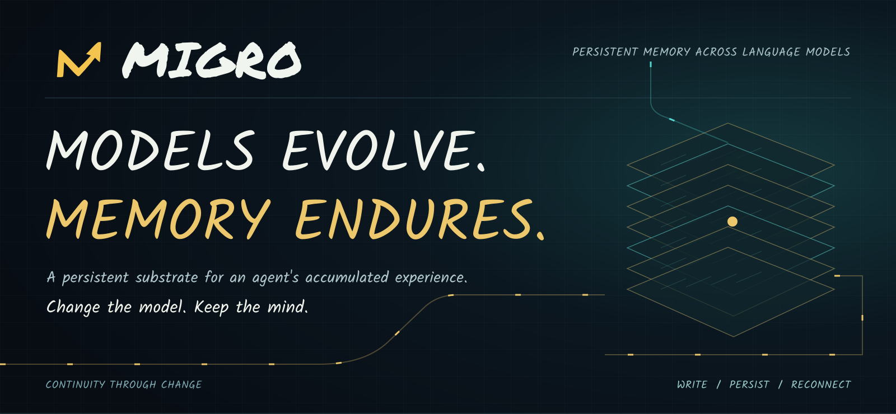
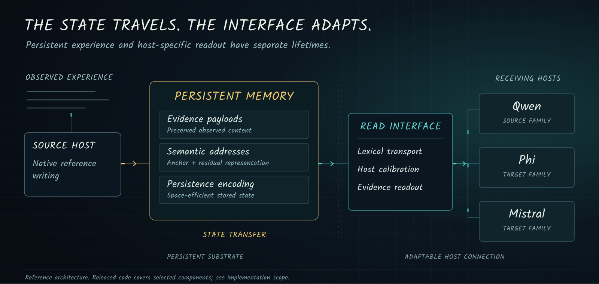
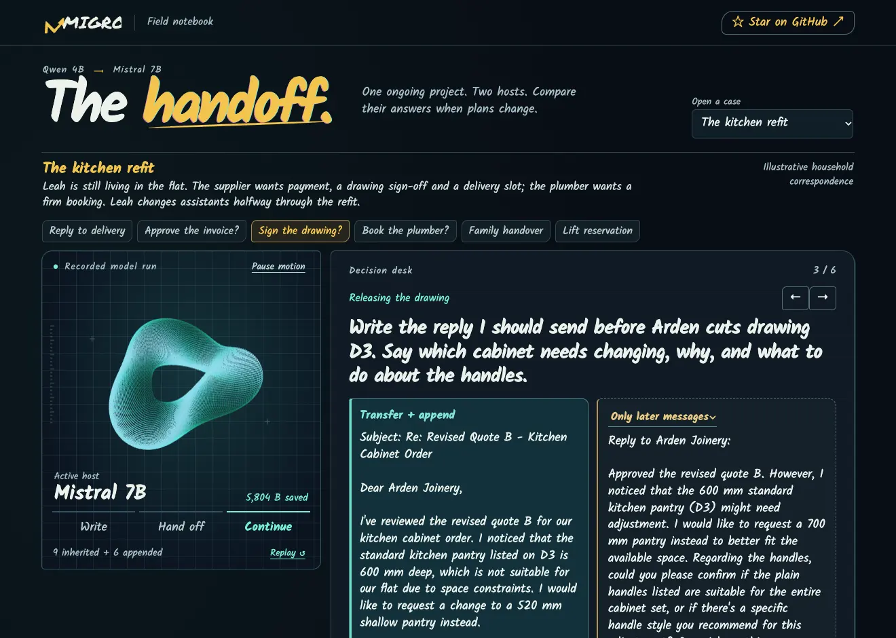
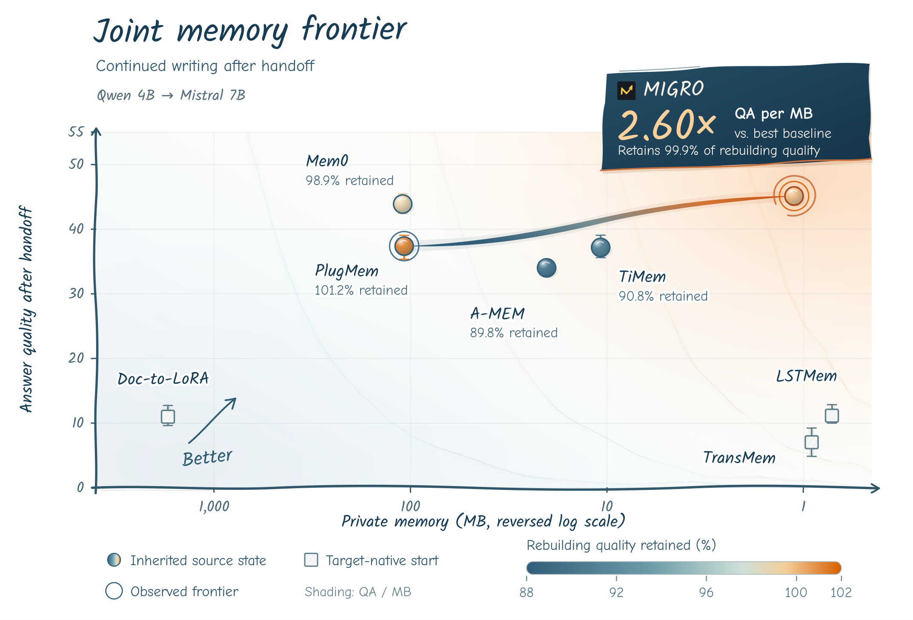

<p align="center">
  <a href="README.md">English</a> &nbsp; · &nbsp; <strong>简体中文</strong> &nbsp; · &nbsp; <a href="README.es.md">Español</a>
</p>

<p align="center">
  
</p>

<p align="center">
  <a href="https://arxiv.org/abs/2611.15315"></a>
  <a href="https://zoumingxi.github.io/MIGRO/"></a>
  
  <a href="LICENSE"></a>
</p>

<p align="center">
  <strong>跨语言模型的持久记忆</strong><br>
  让积累的经验拥有共同的存储底座，让使用它的模型拥有可适配的接口。
</p>

<p align="center">
  <a href="#快速开始">快速开始</a> &nbsp; · &nbsp;
  <a href="https://arxiv.org/abs/2611.15315"><strong>论文 ↗</strong></a> &nbsp; · &nbsp;
  <a href="https://zoumingxi.github.io/MIGRO/"><strong>在线体验 ↗</strong></a> &nbsp; · &nbsp;
  <a href="#为什么选择-migro">项目概览</a> &nbsp; · &nbsp;
  <a href="#系统设计">系统架构</a> &nbsp; · &nbsp;
  <a href="#实验结果">实验结果</a> &nbsp; · &nbsp;
  <a href="docs/README.md">文档</a> &nbsp; · &nbsp;
  <a href="#引用">引用</a>
</p>

---

## 为什么选择 MIGRO

**MIGRO 让长期经验能够跨越语言模型的更换。** 系统将观察、历史关系与检索地址保存在持久状态中，让后续宿主能够接续读取和写入。

- **记忆用得好。** 精确证据与问题驱动的选择，支持长历史中的事件回忆、版本修订和上下文推理。
- **经验可延续。** 通过宿主接口读取已有状态，交接后继续积累新的观察。
- **增长更经济。** 用紧凑语义地址和可逆归档降低持久化开销，保留已保存的证据。

## 项目动态

- **2026-11-12** — [共享运行资源发布](https://github.com/zOUMINGXI/MIGRO/releases/tag/runtime-assets-20261112)，提供核心与宿主接口权重、配置和验证工具。
- **2026-11-11** — [MIGRO 技术报告发布于 arXiv](https://arxiv.org/abs/2611.15315)。

## 快速开始

**直接在线体验。** [打开交互式 Demo](https://zoumingxi.github.io/MIGRO/)，比较已记录的模型回答、切换记忆条件并查看检索证据。也可[下载离线 Demo](https://github.com/zOUMINGXI/MIGRO/raw/refs/heads/main/demo/MIGRO-Handoff.zip)在本地回放。

**从源码安装。** 基础安装提供结果整理工具与便携文本对照。

~~~bash
git clone https://github.com/zOUMINGXI/MIGRO.git
cd MIGRO
python3 -m venv .venv
source .venv/bin/activate
python -m pip install -e .
python scripts/render_results.py --help
~~~

**运行记忆系统。** 按照[运行环境配置](docs/runtime.zh-CN.md)安装运行依赖、下载共享资源、编译编码内核并运行验证，再按照[本地 Demo 指南](demo/README.md#run-your-own-session)配置骨干模型与重排模型，生成新的回答。

[文档索引](docs/README.md) · [实验命令](docs/experiments.md) · [发布范围](docs/release_scope.md)

## 系统设计

<p align="center">
  
</p>

### The Handoff · 交互式 demo

Leah 刚更换助手，厨房供应商就发来确认请求。最新邮件里有新的报价、图纸和送货方案；而她的预算上限、现场尺寸和楼宇限制，仍留在四月的往来邮件中。现在由你接手：先做出自己的判断，再找回早先的上下文，重新考虑这个决定。随后，可以对比五种记忆条件下模型实际生成的答案。第二个案例则根据发布提交，重现了我们自己遇到的 demo 下载支持问题。

[](https://zoumingxi.github.io/MIGRO/)

[**打开交互式 demo ↗**](https://zoumingxi.github.io/MIGRO/) · [下载离线 demo（.zip）](https://github.com/zOUMINGXI/MIGRO/raw/refs/heads/main/demo/MIGRO-Handoff.zip) · [运行自己的会话](demo/README.md#run-your-own-session)

使用浏览器即可打开在线 demo，无需下载或安装。你可以查看已记录的模型运行结果、切换记忆条件，并检查检索出的证据。要根据自己的输入生成新答案，请使用上方链接中的本地运行环境。

### 持久记忆底座，可适配的宿主连接

MIGRO 将存储的经验，与向特定宿主呈现这些经验的机制分开。

**写入保留与真实历史的联系。** 原生参考写入使用源宿主，根据观察到的内容构建记忆。持久化载荷和元数据保留存储内容与其来源经验之间的对应关系。

**寻址和编码承担不同的任务。** 语义地址用于选择证据。Anchor + Residual 表示与仅 Anchor、完整语义地址两种对照进行比较。持久化编码单独评测，包括源 token ID、地址几何关系和元数据的精确恢复。

**读取接口适配接收宿主。** 词汇 transport 将源表示连接到目标词表和嵌入接口；协议允许时，通过校准适配宿主连接。这样的分解让宿主相关的适配成为系统中明确的一部分。

图示描述的是研究架构。已发布代码包含持久状态后端、精确编码内核和 benchmark 入口。共享检查点和数据集单独提供；详见[运行环境配置](docs/runtime.zh-CN.md)。

[架构与组件约定](docs/system_overview.md) · [实现细节](docs/implementation.md) · [消融配置](configs/ablations)

### 迁移状态，或重建历史

迁移协议区分两种具体操作：

|操作|持久状态|目标端工作|
|---|---|---|
|**State Transfer**|复用已有记忆状态。|将状态连接到接收宿主；允许少量读取接口校准，并单独报告。|
|**Full-History Rebuilding**|根据完整原始历史重新构建记忆。|执行目标端构建流程；需要时包含针对该模型的记忆训练。|

**State Transfer** 指状态迁移，**Full-History Rebuilding** 指完整历史重建。标签对应具体运行：一种方法可以同时拥有状态迁移结果，以及在目标端独立重建的对照结果。重建记忆本身，并不意味着微调骨干模型。

[迁移操作与校准预算](docs/migration_protocol.md)

## 实验结果

技术报告从回答质量、跨宿主延续和持久化存储三个方面评估 MIGRO。下列结果分别对应各自的实验样本与计量范围。

| 实验 | 代表性结果 |
|---|---|
| 长期问答 · LongMemEval-S | Qwen 4B 参考宿主下为 **68.40** |
| 交接后续写 · Qwen 4B → Mistral 7B | **45.13**，目标端完整历史重建为 **45.19** |
| 百万 token BEAM 历史 | 五条历史的私人状态平均为 **1.857 MB/条** |
| 共享部署 · 1,000 份独立记忆 | 计入必需共享资源后，平均 **2.154 MB/份** |

[完整基准与对照表](docs/evaluation.zh-CN.md) · [指标与评分](docs/performance_protocol.md) · [迁移设置](docs/migration_protocol.md)

<p align="center">
  <a href="assets/joint_frontier.png"></a>
</p>

<p align="center">
  <strong>带上已有经验，继续写入新的经历。</strong><br>
  Qwen 4B → Mistral 7B 交接后继续写入：回答质量、私有记忆占用，以及相对于目标端重建保留的质量。
</p>

## 已发布组件

仓库提供实现代码和评测流程的入口。

|组件|作用|源码|
|---|---|---|
|**持久状态**|共享 Anchor 与 Residual、精确内容绑定、保存／恢复及继续写入。|[`migro.memory`](src/migro/memory.py)|
|**精确编码**|字面与因果内容编码候选、地址／存档编码，以及原生内核。|[`migro.backend`](src/migro/backend)|
|**Benchmark 运行**|增量 MAB、匹配读取预算、格式感知评分与迁移后继续写入。|[运行实验](docs/experiments.md)|
|**Transport**|词表感知的分段 transport、边界组合与词汇映射。|[`migro.transport`](src/migro/transport.py)|
|**校准**|残差接口与以证据为条件的宿主接口。|[`migro.calibration`](src/migro/calibration.py)|
|**参考写入**|基于观察历史的冻结宿主因果写入。|[`migro.native_writer`](src/migro/native_writer.py)|
|**观察内容处理**|确定性格式化与时间标注。|[`migro.observations`](src/migro/observations.py)|
|**记忆对照**|可移植的 BM25 与近期窗口 baseline。|[`migro.controls`](src/migro/controls.py)|
|**配对分析**|匹配评测组对比与对话级 bootstrap 区间。|[`migro_eval.ablations`](src/migro_eval/ablations.py)|

### 安装

使用 Python 3.10 或更高版本。结果汇总和可移植文本对照使用标准库；transport 与 analysis 可选依赖安装对应模块所需的软件包。

```bash
python -m pip install -e .
python -m pip install -e '.[transport,analysis]'
```

要使用记忆后端和 benchmark 入口，请安装 `.[runtime,benchmarks]`、编译随附内核，并配置共享模型资源。[运行环境配置](docs/runtime.zh-CN.md) · [运行实验](docs/experiments.md) · [组件约定](docs/implementation.md)

### 结果汇总与配对分析

```bash
# 展示仓库中的汇总结果。
python scripts/render_results.py

# 汇总已经完成评分的 LoCoMo 评测组。
python scripts/summarize_locomo.py /path/to/scored_records.json --output summary.json

# 查看配对消融分析接口。
python scripts/summarize_ablations.py --help

# 运行组件与结果汇总检查。
python -m unittest discover -s tests -v
```

汇总工具读取已评分的记录，默认要求完整评测组。逐题评分仍由上游完成。可选依赖不可用时，对应测试会跳过。

[汇总输入格式](docs/reporting_tools.md) · [配对分析用法](docs/implementation.md#paired-analysis)

### 仓库结构

```text
assets/                 视觉标识与系统图
src/migro/              Transport、校准、写入与对照
src/migro_eval/         已评分记录汇总与配对分析
configs/ablations/      组件级实验约定
docs/                   架构、协议与实现说明
results/                精选论文汇总表（CSV / JSON）
scripts/                结果汇总与分析入口
tests/                  组件与结果汇总检查
```

## 发布状态

[共享运行资源](https://github.com/zOUMINGXI/MIGRO/releases/tag/runtime-assets-20261112)和实现代码已发布，包含持久记忆、编码内核、宿主接口、配置与验证工具、Demo 以及文档列出的实验入口。骨干模型、重排模型和数据集从原始发布方获取。[发布范围](docs/release_scope.md)列明了已提供的组件与后续复现工作。

MIGRO 自有代码与运行资源采用 [Apache-2.0](LICENSE) 许可证。打包的上游组件遵循[第三方声明](THIRD_PARTY_NOTICES.md)中的许可证。

## 参与贡献

欢迎改进文档、集成、记忆接口和评测工具。请先阅读[贡献指南](CONTRIBUTING.md)，也可以[报告问题](https://github.com/zOUMINGXI/MIGRO/issues/new?template=bug_report.md)或[提出建议](https://github.com/zOUMINGXI/MIGRO/issues/new?template=feature_request.md)。

## 引用

如果 MIGRO 对你的研究有帮助，欢迎引用[技术报告](https://arxiv.org/abs/2611.15315)。[CITATION.cff](CITATION.cff) 提供可供工具读取的引用信息。

~~~bibtex
@article{zou2026migro,
  title = {{MIGRO}: A Decoupled and Portable Long-Term Memory System for Language Models},
  author = {Zou, Mingxi and
            Xu, Yinghui and
            Chen, Jiaxiang and
            Liang, Langzhang and
            Zhu, Wei and
            Ye, Peng and
            Zhao, Runkai and
            Jiang, Ruoxi and
            Chen, Sijin and
            Wang, Song and
            Wang, Zhuo and
            Qu, Lizhen and
            Xu, Zenglin},
  year = {2026},
  eprint = {2611.15315},
  archivePrefix = {arXiv},
  primaryClass = {cs.AI},
  url = {https://arxiv.org/abs/2611.15315}
}
~~~
