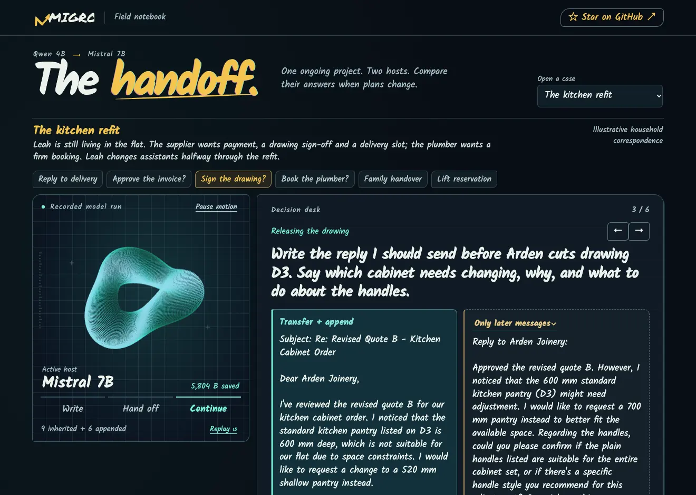

# The Handoff

[**Download MIGRO-Handoff.zip**](https://github.com/zOUMINGXI/MIGRO/raw/refs/heads/main/demo/MIGRO-Handoff.zip). Unzip it and double-click **MIGRO-Handoff.html** to open the interactive replay in your browser. It works offline and includes all nine answers from the recorded Qwen-to-Mistral run.

Select **Both**, hand the state from Qwen to Mistral, then append the change of venue. Expand **Retrieved observations** to read the notes selected for each answer. The wire sculpture illustrates the handoff. The byte counts come from the serialized states. This fictional session is an example, separate from the benchmark results.



## Run your own session

Configure the [runtime assets](../docs/runtime.md) first, including the frozen shared core, coding kernels, tokenizers, Qwen3-4B-Instruct-2507, Mistral-7B-Instruct-v0.3, the Mistral interface and the evidence reranker. The HTML replay can be opened immediately. Generating new answers needs those assets on the machine running Python.

From the repository root, start the local app:

```sh
python demo/serve.py
```

Open `http://127.0.0.1:18764`, choose **Edit session**, change either note and the three questions, then select **Generate with MIGRO**. The host process uses CPU by default. Use `MIGRO_DEVICE=cuda python demo/serve.py` on a GPU machine with sufficient free memory. Models load when a session runs.

For a command-line run:

```sh
MIGRO_DEVICE=cpu python demo/run.py --case demo/session.json --output trace.json
python demo/serve.py --trace trace.json
```

The recording uses the native host-conditioned writer. It serializes the source state, releases Qwen, opens the same bytes for Mistral and generates answers at each stage. After appending, the runner checks that the original token bindings and metadata still match. Reads also check that the stored state stays identical.

The example observations, verbatim answers and retrieved slot IDs are in [session.recorded.json](session.recorded.json).
