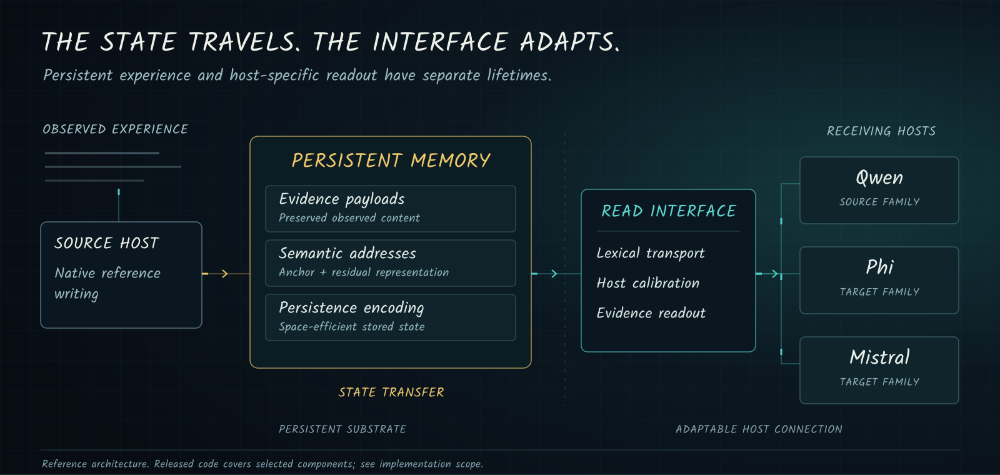

# System overview

MIGRO separates persistent experience from the host-specific interface used to read it. The reference architecture connects observed history, a shared memory substrate and receiving language-model backbones.

This document describes the design and the boundaries of the released components. The complete compressed-state engine, shared-core weights, host checkpoints and end-to-end inference harness are outside the current upload.

## Architectural boundary

A source host constructs memory from observed history. The resulting state retains content, semantic addresses and metadata. A receiving host connects to that state through a read interface.

The design has two distinct lifetimes:

- **Persistent state** follows the accumulated experience.
- **Host interfaces** follow the tokenizer, embedding interface and readout requirements of a particular backbone.

The separation makes the migration operation explicit. State Transfer reuses existing memory. Full-History Rebuilding processes the full raw history to construct target-side memory again.

## Writing and persistent state

### Native reference writing

The released native writer uses a frozen decoder-only host and an application-supplied memory state. It expects that state to expose:

- `core.codec.tokenizer` for the source codec vocabulary;
- `meta` for observation metadata;
- `mem.read_slot` for stored content access;
- `append_many` for adding observations.

The bridge supplies the host model, tokenizer, device and context limit. Callers are responsible for freezing the host before writing.

These are interface contracts. The writer module does not bundle the state backend or supply a pretrained memory system on its own.

### Content, addresses and encoding

Three concerns are kept separate:

|Concern|Purpose|Controlled comparison|
|---|---|---|
|Evidence payloads and metadata|Retain observed content and its source association.|Held fixed when isolating address representation.|
|Semantic addresses|Support evidence selection.|Anchor + residual versus anchor-only and original full addresses.|
|Persistence encoding|Reduce archive size while restoring the intended state.|Full lossless selection versus existing literal candidates and an uncompressed archive.|

The address experiment holds content and metadata fixed and counts standalone address tables, including their headers. Shared basis costs are excluded from that particular table metric and must be accounted for separately when discussing deployment.

The persistence experiment requires exact restoration of source IDs, address geometry, metadata and events. It counts private archive framing and source-ID escapes; shared decoder weights are counted separately. Identical restored states do not require another QA run merely because the archive codec changed.

A result about address representation does not establish a result about archive coding. A private-state byte count does not, by itself, specify the full deployment footprint.

[Address contract](../configs/ablations/addresses.json) · [Persistence contract](../configs/ablations/persistence.json)

## Connecting to a receiving host

### Lexical transport

The transport module exposes a valid-vocabulary piecewise connector and a boundary-composed alternative.

The piecewise connector matches source representations to valid source-vocabulary candidates, then forms target embedding sequences through a lexical mapping. Padding rows outside the tokenizer vocabulary are excluded from candidate selection.

The composed path groups source pieces at inferred boundaries before target tokenization. Its intermediate candidates and query cache belong to the read interface. This comparison concerns a specific composition mechanism; it is not a general claim that transport must outperform native text retokenization.

### Calibration

The calibration module exposes residual and evidence-conditioned host interfaces. Zero-initialized output projections give an identity residual at initialization.

Calibration is part of the receiving-host connection. Its presence does not imply backbone fine-tuning. The protocol records the selected interface, its parameter count and its calibration data separately from the memory construction trajectory.

The frozen research snapshot uses a selected identity interface for Phi and a calibrated read interface for Mistral. Exact budgets and source trajectories are documented in the [migration protocol](migration_protocol.md).

## Experimental boundaries

### Preserve the construction/evaluation boundary

Memory is built from observed history before exposing future question answers. Evaluation labels are not memory construction targets. The paired-analysis tools consume already-scored records; they do not replace benchmark-specific answer scoring.

### Name the operation performed

|Label|What the run does|
|---|---|
|**State Transfer**|Reuses persistent source state with a receiving-host connection. Small interface calibration is allowed when disclosed.|
|**Full-History Rebuilding**|Processes the full history again to construct target memory or the required model-specific memory components.|

A method can have both kinds of run. Rebuilding a memory component does not automatically mean training the backbone. A source-host score subtracted from a target-host score is not, on its own, a measure of migration loss.

### Separate whole-system evidence from component attribution

The experiment contracts include:

- whole-memory efficacy against BM25, recency and no-memory controls;
- boundary composition crossed with frozen calibration;
- alternative semantic address representations;
- lossless persistence encoding choices.

A whole-system gain does not identify which component caused it. The paired analysis requires matching cohorts, retains conversation clusters during bootstrap resampling and reports intervals that can cross zero.

[Experiment contracts](../configs/ablations) · [Paired analysis](implementation.md#paired-analysis)

## Code map and integration

|Released module|Integration responsibility|
|---|---|
|[`transport.py`](../src/migro/transport.py)|Supply source/host embeddings, tokenizers and a compatible lexical mapping.|
|[`calibration.py`](../src/migro/calibration.py)|Attach the selected host interface; supply any permitted calibration separately.|
|[`native_writer.py`](../src/migro/native_writer.py)|Provide the frozen host bridge and persistent-state contract.|
|[`observations.py`](../src/migro/observations.py)|Format the observed history and preserve temporal notes.|
|[`controls.py`](../src/migro/controls.py)|Construct portable text-memory controls from observations.|
|[`ablations.py`](../src/migro_eval/ablations.py)|Compare matched, already-scored conditions.|

The installation and examples in [implementation.md](implementation.md) cover these released components. The current package does not include a complete pretrained memory backend or a single-command reproduction of all benchmark runs.

## Reading the results

The README presents the frozen repository snapshot. LoCoMo uses a post-hoc all-question custom composite rather than official token F1. Other benchmarks retain their recorded research-harness metrics.

Cross-host interpretation must account for both source trajectory and selected interface. See the [performance protocol](performance_protocol.md), [migration protocol](migration_protocol.md) and [release scope](release_scope.md) before using a table as a controlled model comparison.
